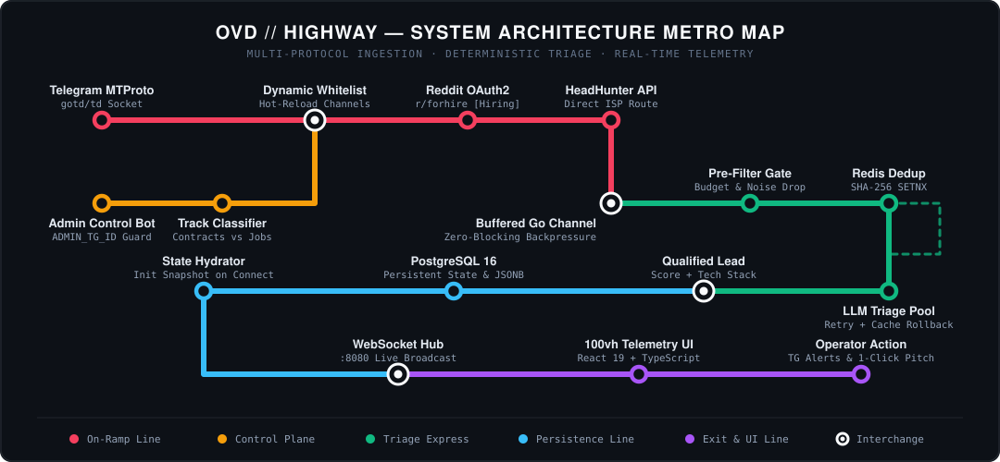

# OVD // HIGHWAY

**Zero-Blocking Multi-Protocol Opportunity Ingestion & AI Qualification Engine**

[](https://github.com/melaven/ovd-highway/actions/workflows/ci.yml)
[](https://go.dev)
[](https://react.dev)
[](https://postgresql.org)
[](https://redis.io)
[](./LICENSE)

<p align="center">
  <a href="./README.md">English</a> ·
  <a href="./docs/README.ru.md">Русский</a> ·
  <a href="./docs/README.es.md">Español</a> ·
  <a href="./docs/README.zh-CN.md">简体中文</a>
</p>

## Overview

OVD HIGHWAY is a multi-protocol system for collecting and AI-qualifying leads from multiple sources — **Telegram (MTProto)**, **Reddit (OAuth2)**, and **HeadHunter API** — paired with a real-time high-density `100vh` telemetry workbench.

It is designed around a **zero-blocking pipeline**: ingestion connectors never stall on downstream processing, failed LLM calls are dead-lettered and retried, and every qualified lead is persisted and streamed to the operator UI over WebSockets.


## System Architecture



- **Onramp** — ingestion entry points: Telegram MTProto listener, Reddit OAuth2 poller, HeadHunter vacancies API
- **Lane** — deterministic pre-filter, Redis deduplication (`SHA-256 SETNX`), LLM triage, circuit breaker
- **Exit** — PostgreSQL persistence, WebSocket broadcast to the React telemetry shell, Telegram alerts & pitch actions

See the full diagram in [`docs/architecture.svg`](./docs/architecture.svg).

## Core Engineering Highlights

- **Zero-Blocking Backpressure** — buffered Go channels decouple connectors from the LLM lane; slow consumers never block ingestion.
- **Official API Protocols** — clean `net/http` clients only: Reddit `client_credentials` OAuth2 with cached token refresh, HeadHunter direct-ISP routing (`Proxy: nil`) with official `HH-User-Agent` headers. No browser spoofing.
- **Circuit Breaker** (`internal/pkg/breaker`) — `Closed → Open → HalfOpen` state machine with single-probe admission and stale-request protection, safe under `-race`.
- **Pre-LLM Filter** (`internal/pipeline`) — deterministic, allocation-light keyword gate that drops spam/low-value signals before they burn OpenRouter tokens.
- **Dead Letter Queue** (`internal/pipeline/dlq` + `migrations/`) — PostgreSQL-backed archive for LLM failures (429/5xx) with `dedupe_key` idempotency and Redis rollback so signals are re-ingested, never silently lost.
- **Real-time Telemetry** — WebSocket hub broadcasting leads to a high-density `100vh` telemetry workbench (React 19 + TypeScript).

## Repository Structure

```
ovd-highway/
├── cmd/engine/          # Go engine entrypoint
├── internal/
│   ├── onramp/          # Connectors: mtproto, reddit (OAuth2), hh
│   ├── lane/            # Processing: dedup, prefilter, LLM triage
│   ├── exit/            # Output: Telegram bot, WebSocket hub
│   ├── pipeline/        # prefilter + dlq packages
│   ├── pkg/breaker/     # Circuit breaker
│   ├── store/           # PostgreSQL persistence (pgx)
│   ├── api/             # HTTP/WebSocket API
│   └── domain/          # Shared types (RawSignal, QualifiedLead)
├── migrations/          # SQL migrations (dead_letter_signals, ...)
├── ui/                  # React 19 + Vite + Tailwind dashboard
├── docs/                # Localized READMEs + architecture diagram
└── .github/workflows/   # CI: race-detector tests, linux build, ui build
```

## Quick Start

### Backend

```bash
go mod tidy
go run cmd/engine/main.go
```

Required environment variables are documented in [`.env.example`](./.env.example) (database, Redis, LLM, Telegram, Reddit OAuth2 credentials).

### Frontend

```bash
cd ui
npm install
npm run dev    # Development on http://localhost:5173
npm run build  # Production build
```

See also [`ui/README.md`](./ui/README.md) for dashboard details.

### Tests & CI

```bash
go test -race ./...
```

GitHub Actions runs backend tests with the race detector, cross-compiles the Linux binary, and builds the UI on every push/PR to `main` — see [`.github/workflows/ci.yml`](./.github/workflows/ci.yml).

### Health & Readiness Probes

The engine exposes two unauthenticated probe endpoints on the same HTTP server as the WebSocket (`WS_ADDR`, default `:8080`):

- `GET /healthz` — process liveness. Always returns `200 OK` with `{"status":"ok"}` while the process is running.
- `GET /readyz` — dependency readiness. Pings PostgreSQL and Redis (2s timeout per check). Returns `200 OK` with `{"status":"ready","checks":{"postgres":"ok","redis":"ok"}}` when all dependencies are healthy, or `503 Service Unavailable` with `{"status":"not_ready","checks":{...}}` where a failing check maps to its error text.

## License

This project is licensed under the [MIT License](./LICENSE) — © 2026 Maxim Kadochnikov.

## Author

**Maxim Kadochnikov (Melaven)** — Full-Stack & Infrastructure Engineer

-  Website: https://melaven-dev.vercel.app/
- GitHub: https://github.com/melaven
- 𝕏: https://x.com
-  Discord: `@melaven`
-  Email: work.melaven@gmail.com
