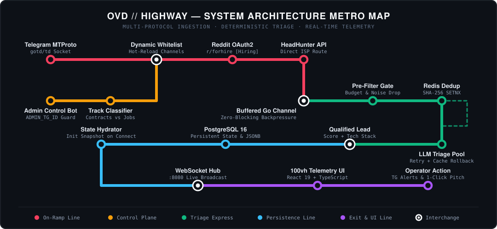

# OVD // HIGHWAY

**Zero-Blocking Multi-Protocol Opportunity Ingestion & AI Qualification Engine**

[](https://github.com/melaven/ovd-highway/actions/workflows/ci.yml)
[](https://go.dev)
[](https://react.dev)
[](https://postgresql.org)
[](https://redis.io)
[](../LICENSE)

<p align="center">
  <a href="../README.md">English</a> ·
  <a href="./README.ru.md">Русский</a> ·
  <a href="./README.es.md">Español</a> ·
  <a href="./README.zh-CN.md">简体中文</a>
</p>

## Descripción general

OVD HIGHWAY es un sistema multiprotocolo para la recopilación y cualificación con IA de leads desde múltiples fuentes — **Telegram (MTProto)**, **Reddit (OAuth2)** y **HeadHunter API** — junto con un telemetry workbench de alta densidad `100vh` en tiempo real.

Está diseñado en torno a un **pipeline zero-blocking**: los conectores de ingesta nunca se bloquean en el procesamiento posterior, las llamadas fallidas al LLM se archivan en dead letter queue y se reintentan, y cada lead cualificado se persiste y se transmite al operador por WebSockets.


## Arquitectura del sistema



- **Onramp** — puntos de entrada de ingesta: listener de Telegram MTProto, poller de Reddit OAuth2, API de vacantes de HeadHunter
- **Lane** — pre-filter determinista, deduplicación en Redis (`SHA-256 SETNX`), triage con LLM, circuit breaker
- **Exit** — persistencia en PostgreSQL, broadcast por WebSocket al shell de telemetría React, alertas de Telegram y acciones de pitch

Diagrama completo en [`docs/architecture.svg`](./architecture.svg).

## Aspectos técnicos destacados

- **Zero-Blocking Backpressure** — canales Go con buffer desacoplan los conectores del carril LLM; los consumidores lentos nunca bloquean la ingesta.
- **Protocolos API oficiales** — solo clientes `net/http` limpios: Reddit `client_credentials` OAuth2 con token cacheado y renovación, HeadHunter con enrutamiento directo por ISP (`Proxy: nil`) y cabeceras oficiales `HH-User-Agent`. Sin suplantación de navegador.
- **Circuit Breaker** (`internal/pkg/breaker`) — máquina de estados `Closed → Open → HalfOpen` con admisión de una única sonda y protección contra peticiones obsoletas, segura bajo `-race`.
- **Pre-LLM Filter** (`internal/pipeline`) — puerta de palabras clave determinista y ligera que descarta spam y pedidos de bajo valor antes de consumir tokens de OpenRouter.
- **Dead Letter Queue** (`internal/pipeline/dlq` + `migrations/`) — archivo en PostgreSQL para fallos del LLM (429/5xx) con idempotencia por `dedupe_key` y rollback de Redis para re-ingestar señales sin perderlas.
- **Telemetría en tiempo real** — hub WebSocket que emite leads a un telemetry workbench de alta densidad `100vh` (React 19 + TypeScript).

## Estructura del repositorio

```
ovd-highway/
├── cmd/engine/          # Punto de entrada del engine en Go
├── internal/
│   ├── onramp/          # Conectores: mtproto, reddit (OAuth2), hh
│   ├── lane/            # Procesamiento: dedup, prefilter, triage LLM
│   ├── exit/            # Salida: bot de Telegram, hub WebSocket
│   ├── pipeline/        # Paquetes prefilter + dlq
│   ├── pkg/breaker/     # Circuit breaker
│   ├── store/           # Persistencia PostgreSQL (pgx)
│   ├── api/             # API HTTP/WebSocket
│   └── domain/          # Tipos compartidos (RawSignal, QualifiedLead)
├── migrations/          # Migraciones SQL (dead_letter_signals, ...)
├── ui/                  # Dashboard de telemetría React 19 + Vite + Tailwind
├── docs/                # READMEs localizados + diagrama de arquitectura
└── .github/workflows/   # CI: tests con race detector, build linux, build ui
```

## Inicio rápido

### Backend

```bash
go mod tidy
go run cmd/engine/main.go
```

Las variables de entorno necesarias están documentadas en [`.env.example`](../.env.example) (base de datos, Redis, LLM, Telegram, credenciales OAuth2 de Reddit).

### Frontend

```bash
cd ui
npm install
npm run dev    # Desarrollo en http://localhost:5173
npm run build  # Build de producción
```

Consulta también [`ui/README.md`](../ui/README.md) para más detalles del panel.

### Tests y CI

```bash
go test -race ./...
```

GitHub Actions ejecuta los tests del backend con el race detector, compila el binario para Linux y construye la UI en cada push/PR a `main` — ver [`.github/workflows/ci.yml`](../.github/workflows/ci.yml).

## Licencia

Este proyecto está licenciado bajo la [Licencia MIT](../LICENSE) — © 2026 Maxim Kadochnikov.

## Autor

**Maxim Kadochnikov (Melaven)** — Full-Stack & Infrastructure Engineer

- 🌐 Sitio web: https://melaven-dev.vercel.app/
- 🐙 GitHub: https://github.com/melaven
- 𝕏 X: https://x.com
- 💬 Discord: `@melaven`
- ✉️ Email: work.melaven@gmail.com