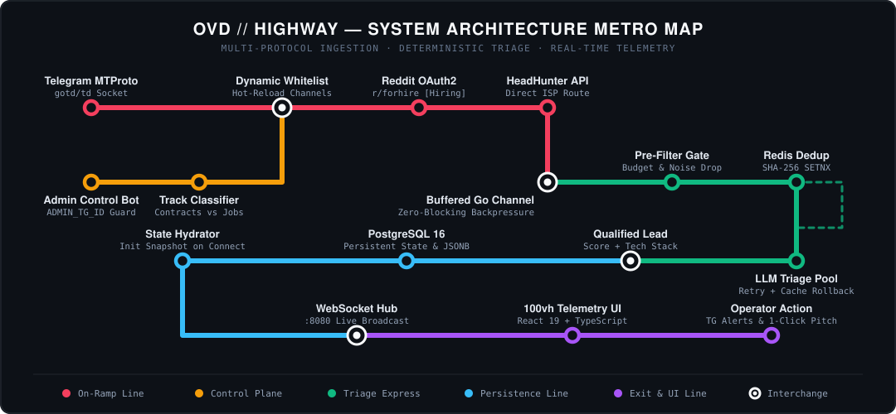

# OVD // HIGHWAY

**Zero-Blocking Multi-Protocol Opportunity Ingestion & AI Qualification Engine**

[](https://github.com/melaven/ovd-highway/actions/workflows/ci.yml)
[](https://go.dev)
[](https://react.dev)
[](https://postgresql.org)
[](https://redis.io)
[](../LICENSE)

<p align="center">
  <a href="../README.md">English</a> ·
  <a href="./README.ru.md">Русский</a> ·
  <a href="./README.es.md">Español</a> ·
  <a href="./README.zh-CN.md">简体中文</a>
</p>

## Обзор

OVD HIGHWAY — мультипротокольная система сбора и AI-квалификации лидов из нескольких источников — **Telegram (MTProto)**, **Reddit (OAuth2)** и **HeadHunter API** — в комплекте с высокоплотным `100vh` telemetry workbench с обновлениями в реальном времени.

Система построена вокруг **zero-blocking пайплайна**: коннекторы инжеста никогда не блокируются на downstream-обработке, упавшие LLM-запросы попадают в dead letter queue и переотправляются, а каждый квалифицированный лид сохраняется в базу и транслируется оператору через WebSockets.


## Архитектура системы



- **Onramp** — точки входа инжеста: Telegram MTProto listener, Reddit OAuth2 poller, HeadHunter vacancies API
- **Lane** — детерминированный pre-filter, дедупликация в Redis (`SHA-256 SETNX`), LLM-триаж, circuit breaker
- **Exit** — персистентность в PostgreSQL, WebSocket-трансляция в React telemetry shell, Telegram-алерты и pitch-действия

Полная диаграмма: [`docs/architecture.svg`](./architecture.svg).

## Ключевые инженерные решения

- **Zero-Blocking Backpressure** — буферизованные Go-каналы отделяют коннекторы от LLM-линии; медленные потребители не блокируют инжест.
- **Официальные API-протоколы** — только чистые `net/http` клиенты: Reddit `client_credentials` OAuth2 с кешированным обновлением токена, HeadHunter с прямым ISP-маршрутом (`Proxy: nil`) и официальными заголовками `HH-User-Agent`. Никакого browser spoofing.
- **Circuit Breaker** (`internal/pkg/breaker`) — автомат состояний `Closed → Open → HalfOpen` с единственным probe-запросом и защитой от stale-запросов, безопасен под `-race`.
- **Pre-LLM Filter** (`internal/pipeline`) — детерминированный, экономный по памяти keyword-фильтр, отсекающий спам и дешёвые заказы до того, как они сожгут токены OpenRouter.
- **Dead Letter Queue** (`internal/pipeline/dlq` + `migrations/`) — архив на PostgreSQL для сбоев LLM (429/5xx) с идемпотентностью по `dedupe_key` и откатом Redis-ключа, чтобы сигналы переинжестировались, а не терялись молча.
- **Real-time Telemetry** — WebSocket-хаб, транслирующий лиды в высокоплотный `100vh` telemetry workbench (React 19 + TypeScript).

## Структура репозитория

```
ovd-highway/
├── cmd/engine/          # Точка входа Go-движка
├── internal/
│   ├── onramp/          # Коннекторы: mtproto, reddit (OAuth2), hh
│   ├── lane/            # Обработка: дедупликация, prefilter, LLM-триаж
│   ├── exit/            # Выход: Telegram-бот, WebSocket-хаб
│   ├── pipeline/        # Пакеты prefilter + dlq
│   ├── pkg/breaker/     # Circuit breaker
│   ├── store/           # Персистентность PostgreSQL (pgx)
│   ├── api/             # HTTP/WebSocket API
│   └── domain/          # Общие типы (RawSignal, QualifiedLead)
├── migrations/          # SQL-миграции (dead_letter_signals, ...)
├── ui/                  # React 19 + Vite + Tailwind дашборд
├── docs/                # Локализованные README + диаграмма архитектуры
└── .github/workflows/   # CI: тесты с race-детектором, linux-сборка, ui-сборка
```

## Быстрый старт

### Backend

```bash
go mod tidy
go run cmd/engine/main.go
```

Необходимые переменные окружения описаны в [`.env.example`](../.env.example) (база данных, Redis, LLM, Telegram, учётные данные Reddit OAuth2).

### Frontend

```bash
cd ui
npm install
npm run dev    # Development на http://localhost:5173
npm run build  # Production сборка
```

Подробнее о дашборде — в [`ui/README.md`](../ui/README.md).

### Тесты и CI

```bash
go test -race ./...
```

GitHub Actions запускает backend-тесты с race-детектором, кросс-компилирует Linux-бинарь и собирает UI при каждом push/PR в `main` — см. [`.github/workflows/ci.yml`](../.github/workflows/ci.yml).

## Лицензия

Проект распространяется по [лицензии MIT](../LICENSE) — © 2026 Maxim Kadochnikov.

## Автор

**Максим Кадочников (Melaven)** — Full-Stack & Infrastructure Engineer

- 🌐 Сайт: https://melaven-dev.vercel.app/
- 🐙 GitHub: https://github.com/melaven
- 𝕏 X: https://x.com
- 💬 Discord: `@melaven`
- ✉️ Email: work.melaven@gmail.com