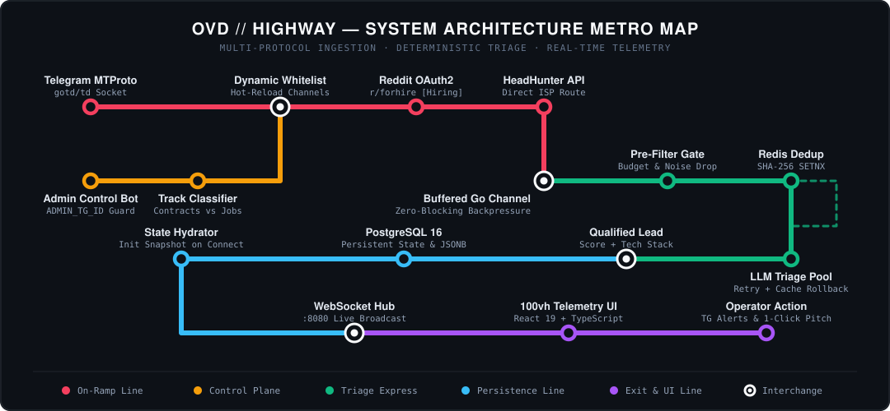

# OVD // HIGHWAY

**Zero-Blocking Multi-Protocol Opportunity Ingestion & AI Qualification Engine**

[](https://github.com/melaven/ovd-highway/actions/workflows/ci.yml)
[](https://go.dev)
[](https://react.dev)
[](https://postgresql.org)
[](https://redis.io)
[](../LICENSE)

<p align="center">
  <a href="../README.md">English</a> ·
  <a href="./README.ru.md">Русский</a> ·
  <a href="./README.es.md">Español</a> ·
  <a href="./README.zh-CN.md">简体中文</a>
</p>

## 概述

OVD HIGHWAY 是一个多协议商机采集与 AI 资格评估引擎，从多个来源 —— **Telegram（MTProto）**、**Reddit（OAuth2）** 和 **HeadHunter API** —— 收集并筛选线索，并配备实时高密度 `100vh` telemetry workbench。

系统围绕 **zero-blocking（零阻塞）流水线** 设计：采集连接器绝不会被下游处理阻塞，失败的 LLM 调用会进入死信队列并重试，每条合格线索都会持久化并通过 WebSockets 实时推送给运营者。


## 系统架构



- **Onramp（接入层）** — 采集入口：Telegram MTProto 监听器、Reddit OAuth2 轮询器、HeadHunter 招聘 API
- **Lane（处理层）** — 确定性预过滤、Redis 去重（`SHA-256 SETNX`）、LLM 分诊、熔断器
- **Exit（输出层）** — PostgreSQL 持久化、WebSocket 广播至 React 遥测界面、Telegram 告警与一键 pitch

完整架构图见 [`docs/architecture.svg`](./architecture.svg)。

## 核心工程亮点

- **Zero-Blocking 背压控制** — 带缓冲的 Go channel 将连接器与 LLM 通道解耦；慢消费者绝不会阻塞采集。
- **官方 API 协议** — 仅使用纯净的 `net/http` 客户端：Reddit `client_credentials` OAuth2（带缓存的令牌刷新）、HeadHunter 直连 ISP 路由（`Proxy: nil`）及官方 `HH-User-Agent` 请求头。无浏览器伪装。
- **熔断器**（`internal/pkg/breaker`）— `Closed → Open → HalfOpen` 状态机，单探针准入并防止过期请求干扰，`-race` 下安全。
- **LLM 前置过滤器**（`internal/pipeline`）— 确定性、低内存开销的关键词过滤，在消耗 OpenRouter 令牌之前拦截垃圾信息和低价值订单。
- **死信队列**（`internal/pipeline/dlq` + `migrations/`）— 基于 PostgreSQL 的 LLM 故障（429/5xx）归档，`dedupe_key` 幂等，并通过 Redis 回滚键确保信号可重新摄入而非静默丢失。
- **实时遥测** — WebSocket 中枢将线索广播至基于 React 19 + TypeScript 的高密度 `100vh` telemetry workbench。

## 仓库结构

```
ovd-highway/
├── cmd/engine/          # Go 引擎入口
├── internal/
│   ├── onramp/          # 连接器：mtproto、reddit（OAuth2）、hh
│   ├── lane/            # 处理：去重、prefilter、LLM 分诊
│   ├── exit/            # 输出：Telegram 机器人、WebSocket 中枢
│   ├── pipeline/        # prefilter + dlq 包
│   ├── pkg/breaker/     # 熔断器
│   ├── store/           # PostgreSQL 持久化（pgx）
│   ├── api/             # HTTP/WebSocket API
│   └── domain/          # 共享类型（RawSignal、QualifiedLead）
├── migrations/          # SQL 迁移（dead_letter_signals 等）
├── ui/                  # React 19 + Vite + Tailwind 仪表盘
├── docs/                # 本地化 README + 架构图
└── .github/workflows/   # CI：race 检测测试、Linux 构建、UI 构建
```

## 快速开始

### 后端

```bash
go mod tidy
go run cmd/engine/main.go
```

所需环境变量见 [`.env.example`](../.env.example)（数据库、Redis、LLM、Telegram、Reddit OAuth2 凭据）。

### 前端

```bash
cd ui
npm install
npm run dev    # 开发模式，访问 http://localhost:5173
npm run build  # 生产构建
```

仪表盘详情另见 [`ui/README.md`](../ui/README.md)。

### 测试与 CI

```bash
go test -race ./...
```

GitHub Actions 在每次 push/PR 到 `main` 时运行带 race 检测器的后端测试、交叉编译 Linux 二进制并构建 UI —— 见 [`.github/workflows/ci.yml`](../.github/workflows/ci.yml)。

## 许可证

本项目采用 [MIT 许可证](../LICENSE) —— © 2026 Maxim Kadochnikov。

## 作者

**Maxim Kadochnikov（Melaven）** — 全栈与基础设施工程师

- 🌐 网站：https://melaven-dev.vercel.app/
- 🐙 GitHub：https://github.com/melaven
- 𝕏 X：https://x.com
- 💬 Discord：`@melaven`
- ✉️ 邮箱：work.melaven@gmail.com